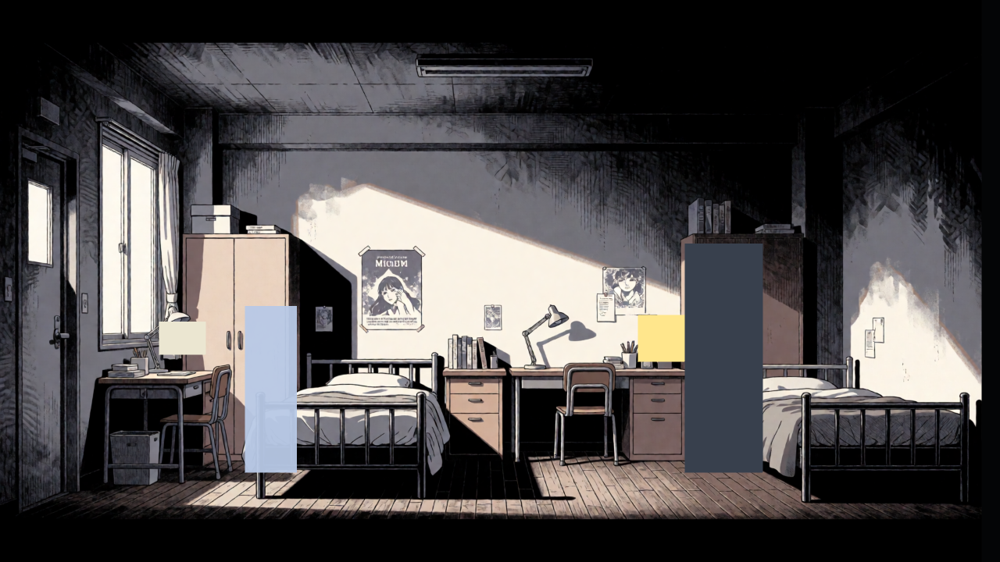
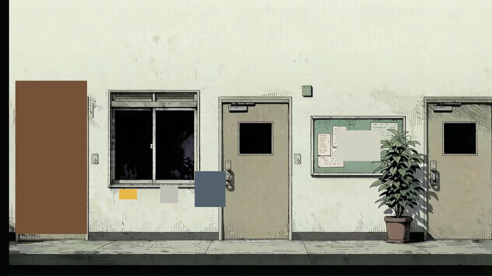

# 225：熄灯后

2D 横版校园惊悚·潜行解谜游戏（课程项目，Unity / Windows PC，单机离线）。

深夜熄灯后宿舍楼停电，225 宿舍六人全部幸存。玩家操控其中一人，从 225 房间出发，靠搜集线索、躲藏、观察巡逻规律与操作机关，避开鬼怪，打开楼梯间与一楼出口，带所有室友撤离。

## 文档

| 文档 | 说明 |
|---|---|
| [docs/策划案.md](docs/策划案.md) | 完整策划案 V1.0：定位、玩法规则、关卡、UI、数值、状态、架构、测试用例 |
| [docs/分工表.md](docs/分工表.md) | 六人分工：总览、每人简略分工表、里程碑分工、协作约定 |
| [docs/交互接口说明.md](docs/交互接口说明.md) | 成员4 接口契约：四态与提示、背包、任务标记、躲藏、谜题机关、接入示例 |
| [docs/谜题用例表.md](docs/谜题用例表.md) | 主线谜题链、物品/线索配置、23 条用例与 T03/T06/T07/T08/T11 覆盖 |
| [docs/周会记录.md](docs/周会记录.md) | 周会议题与决议、任务看板、行动项、风险 |
| [docs/成员4-交付清单.md](docs/成员4-交付清单.md) | 成员4 交付物、代码结构、测试证据与待联调事项 |
| [docs/测试/成员4-自测记录.md](docs/测试/成员4-自测记录.md) | 46 条 EditMode 用例的环境、结果、失败修复过程与未覆盖项 |
| [docs/资源清单.md](docs/资源清单.md) | 素材来源、授权与修改登记（含两张场景图的 AI 核验表） |
| [docs/测试/场景预览/](docs/测试/场景预览/) | 联调场景渲染预览（宿舍 / 走廊 / 拼接处），用于核对背景与交互物位置 |
| [docs/原件/](docs/原件/) | 策划案 docx 原件存档 |

## 分工速览

| 成员 | 模块 | 负责内容 | 分支 |
|---|---|---|---|
| 练悦 | 玩家与镜头 | 移动/奔跑耐力/碰撞、镜头跟随、操作教学 | `feature/player` |
| 庞延新 | 鬼怪 AI | 巡逻—调查—追逐—返回状态机、视听感知、抓捕判定 | `feature/enemy` |
| 彭靖毅 | 关卡 | 225 宿舍、二楼走廊、楼梯门厅灰盒与碰撞/检查点 | `feature/level` |
| 庞华杰 | 交互与解谜 | 拾取/背包、条件交互、保险丝与门禁谜题（负责人） | `feature/puzzle` |
| 廖浩廷 | UI 与音画 | 菜单/HUD/对话、音效接入、灯光氛围 | `feature/ui` |
| 何奕佳 | 流程与集成 | 状态机、任务状态、场景衔接、检查点、构建回归 | `feature/integration` |

每人计划工作量约 1/6；个人贡献以 Git 提交、资源文件与测试证据核验。详细任务、交付物与验收用例见 [docs/分工表.md](docs/分工表.md)。

## 里程碑

| 阶段 | 目标 | 门槛 |
|---|---|---|
| M1 玩法原型 | 移动、交互、灰盒走廊、基础鬼怪触发 | 可重复完成「探索—躲避—拾取」 |
| M2 功能开发 | 谜题链、HUD、AI 追踪、失败重试 | 主任务可从 225 房间连续推进 |
| M3 整合修改 | 串联三段区域，补对话/音画/检查点 | 不依赖编辑器即可完整试玩 |
| M4 最终验收 | Windows 构建、演示、材料归档 | 可启动、可通关、文档一致 |

## 开发环境

- Unity 2022.3.62f3c1（已建工程并锁定；Product Name `D225`，Company `vivo50`）
- 包依赖：`com.unity.test-framework 1.1.33`、`com.unity.ugui 1.0.0`，其余为内置模块
- C#、Git；键鼠输入；不引入在线账号、云服务或付费插件

## 快速开始

1. 用 Unity Hub 以 **2022.3.62f3c1** 打开仓库根目录（工程根即仓库根）。
2. 生成成员4 的物品配置与可交互物 Prefab：菜单 `D225/生成交互与谜题资源`（生成器已入库，可重复执行）。
3. 打开 `Assets/Scenes/D225_Sandbox_Puzzle.unity` 按 Play：**A / D 移动、Shift 奔跑、E 交互**；可完成拾取、调查、躲藏、保险丝与门禁谜题。
4. 跑测试：`Window > General > Test Runner > EditMode > Run All`，当前应为 46/46 通过。
5. 接入交互：玩家挂 `Inventory` 并实现 `IHidableActor`，按 [docs/交互接口说明.md](docs/交互接口说明.md) 第 5 节调用 `IInteractable`；任务进度可直接拖 `Assets/Prefabs/Items/D225_QuestController.prefab` 作为场景根。

> 联调场景由菜单 `D225/生成交互联调场景` 生成，背景为 `Assets/Art/Level` 下两张场景图；生成时需关闭其他占用该工程的 Unity 实例。

## 仓库结构

```
Assets/
  Scripts/Interact/   成员4：交互契约、四态交互物、背包、拾取/线索、躲藏点、谜题机关
  Scripts/Quest/      成员4：PuzzleFlag、IQuestLog、任务目标
  Scripts/Sandbox/    成员4：联调场景的占位角色、交互入口、镜头与 HUD（正式版由成员1/5 替换）
  Data/Items/         物品与线索配置（ItemData）
  Prefabs/Items/      可交互物 / 机关 / 任务根 Prefab
  Art/Level/          A 区宿舍、B 区走廊两张场景背景（AI 生图，已登记）
  Art/Placeholder/    自制色块占位图
  Scenes/             D225_Sandbox_Puzzle.unity：成员4 的 A/B 区联调场景（正式关卡由成员3 制作）
  Tests/Interact/     46 条 EditMode 用例与测试支撑
  Scripts/Player 等   其他成员后续提交
Packages/             依赖清单（test-framework、ugui）
ProjectSettings/      工程设置（Unity 2022.3.62f3c1）
docs/                 策划、分工、接口、用例、周会、测试与资源登记
```

推荐脚本分区：`Scripts/Core`、`Scripts/Player`、`Scripts/Enemy`、`Scripts/Interact`、`Scripts/Quest`、`Scripts/UI`。

## 协作

- `main` 保持可运行；功能在 `feature/*` 分支开发，合并前由另一名成员检查。
- 提交说明：`修改对象 — 完成内容 — 验证方式`。
- 同一 Scene 同一时间只由一人编辑；`Library`、`Temp`、`Logs` 与构建缓存不入库。
- 素材登记来源与授权；AI 辅助内容按课程要求填写核验记录。

## 场景预览

联调场景（A 区 225 宿舍 / B 区二楼走廊）由场景相机渲染，仅用于核对背景与交互物位置；实际可玩版本请打开 `Assets/Scenes/D225_Sandbox_Puzzle.unity` 按 Play。





## 状态

- 已就位：策划案 V1.0、分工表、Unity 2022.3.62f3c1 工程骨架。
- 成员4（交互与解谜）：交互契约、拾取/背包、条件交互、谜题链、躲藏点、12 个 Prefab 与 46 条 EditMode 用例已完成并通过，见 [docs/成员4-交付清单.md](docs/成员4-交付清单.md)。
- 场景与美术：两张场景图已作为 A/B 区背景接入，并生成可操作联调场景（[交付清单](docs/成员4-交付清单.md) 第 7 节）；角色、镜头与 HUD 为占位，正式版本由成员1/5 替换。
- 其余模块（玩家与镜头、鬼怪 AI、关卡、UI 与音画、流程与集成）仍为设计目标，尚未提交代码；仓库中未标注为已完成的功能均属计划。
