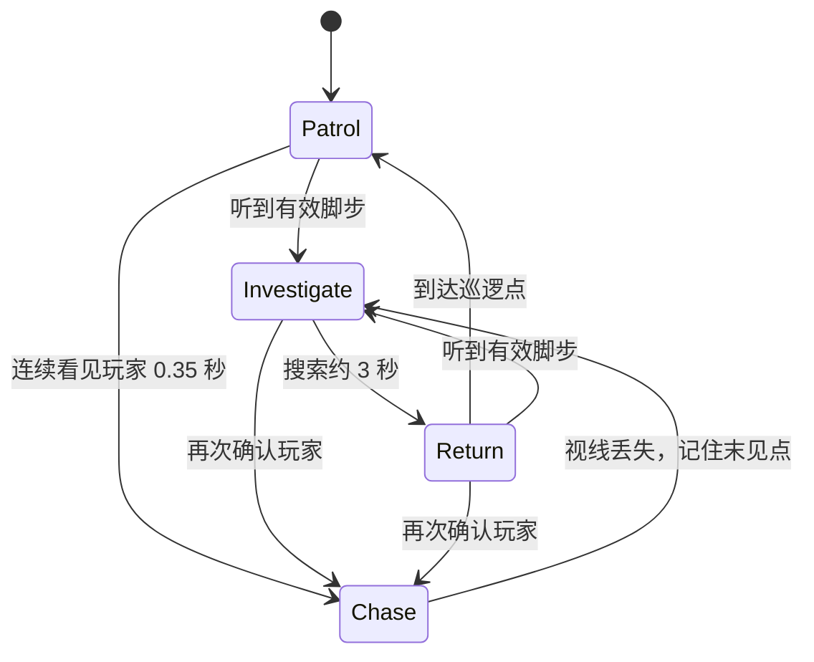

# 《225：熄灯后》成员 2 鬼怪 AI 交付说明

**负责人**　庞延新　｜　**分支**　`feature/enemy`　｜　**Unity**　`2022.3.62f3c1`

按团队分工 2-1 至 2-6 整理，基于 [GitHub main 的 59ad62c](https://github.com/Longqc666/vivo50-gameProject/tree/59ad62ca574cd7b9a6b8980c9489e2f47a594e37) 的玩家、交互和关卡接口。运行状态见[验证记录](测试/成员2-鬼怪AI验证记录.md)。

## 工作内容

| 分工 | 实现 | 对应验收 |
| --- | --- | --- |
| 2-1 四态状态机 | `EnemyAI` 统一处理巡逻、调查、追逐、返回，`StateChanged` 提供状态通知 | T04 |
| 2-2 巡逻路点 | 沿 Inspector 配置的顺序来回走，端点折返。Scene 视图可显示路点及相邻连线 | T04 |
| 2-3 视觉感知 | 前向约 4.5 单位，高度差不超过 1.2 单位，识别时间 0.35 秒。实体墙和 `VisionBlocker` 帘布遮挡视线 | T05 |
| 2-4 听觉感知 | 接入玩家现有 `PlayerNoise.NoiseEmitted`。脚步半径由玩家配置，步行 2、奔跑 5。调查声源上报时的位置 | T05 |
| 2-5 追逐与脱离 | 巡逻速度 2.1、追逐 4.1 单位/秒。丢失视线后前往最后一次看到玩家的位置，搜索约 3 秒后返回可达路点。受实体墙阻挡时在墙这一侧搜索 | T05、T06 |
| 2-6 抓捕与复位 | 追逐中达到接触容差、射线无阻挡、玩家未躲藏时调用 `PlayerHiding.SetCatchLocked(true)`，然后发出一次 `PlayerCaught`。`ResetToSpawn()` 复位鬼怪 | T06、T09、T10 |

抓捕判定发生在 `Chase` 中。有效抓捕后锁定本轮追击并发出事件，重试时清空记忆、计时与抓捕标记，鬼怪回到出生点。

## 文件与复现入口

| 路径 | 用途 |
| --- | --- |
| `Assets/Scripts/Enemy/EnemyAI.cs` | 状态、计时、路点、噪声订阅、复位 |
| `Assets/Scripts/Enemy/EnemyPerception.cs` | 前向视野、射线遮挡、水平返回路线检查 |
| `Assets/Scripts/Enemy/EnemyCatch.cs` | 接触判定、玩家锁定、抓捕通知 |
| `Assets/Prefabs/Enemy/D225_Enemy.prefab` | 鬼怪的刚体、碰撞体、感知和抓捕组件 |
| `Assets/Scenes/D225_EnemyTest.unity` | 独立走廊、试验墙、储物柜和玩家，配合 `EnemyDemoSession` 演示 |
| `Assets/Editor/D225/Enemy/` | 打开测试场景、执行验证、在当前 B/C 场景挂接鬼怪 |

1. 用 `2022.3.62f3c1` 打开已合入这些文件的项目。在 Unity 里选择 `D225 > Enemy > 1. Open Test Scene`，点击 **Play**，再点 **Game** 窗口。
2. `A/D` 或方向键移动，左 `Shift` 奔跑，走近青绿色柜子按 `E` 进出，`Esc` 暂停，`R` 重试。鬼怪紫色为巡逻、黄色为调查、红色为追逐、青色为返回。白色标记显示朝向。
3. 停止 Play 后，选择 `D225 > Enemy > 2. Verify Test Scene`。逐项结果见 Console 中的 `[Enemy Verify]` 和项目下 `Logs/D225EnemyVerification.txt`。

## 与团队模块接入

| 对接成员 | 接入位置 | 接入方式 |
| --- | --- | --- |
| 练悦 | 玩家 Prefab | 使用 `PlayerNoise`、`PlayerHiding` 和 `PlayerDetection`。玩家进入追逐时收到 `NotifyDetected()`，抓捕时先锁定控制 |
| 彭靖毅 | `Scene_B_Corridor`、`Scene_C_Hall` | 在目标场景选择 `D225 > Enemy > 3. Place Enemy in Active B or C Scene`。工具找场景中的正式玩家与 `Patrol_WP_*`，按 X 排序填入 B 区 5 个、C 区 3 个路点。工具生成待保存的实例，场景负责人可先核对再保存 |
| 廖浩廷 | 威胁提示、音效和失败页 | 订阅 `EnemyAI.StateChanged`；由流程模块在有效抓捕后调用 `UiRouter.ShowFail()` |
| 何奕佳 | 失败、暂停、检查点 | 订阅 `EnemyCatch.PlayerCaught`；退出探索时可调用 `SetSimulationActive(false)`。重试先 `PlayerHiding.ResetAfterFailure()`，再由流程定位玩家、调用 `EnemyAI.ResetToSpawn()` 并恢复探索。正式检查点保留关键任务由流程模块负责 |

B/C 使用同层、可通行的固定巡逻线。遮挡帘可被角色穿过，实体墙需要配置到 `Obstacle Mask`。识别时间 0.35 秒、到点容差 0.15 单位、接触容差 0.12 单位和受阻判断 0.6 秒是当前实现值，适合在场景试玩后调整。

## 个人贡献和资源登记

| 资源 | 来源与修改 | 核验方式 |
| --- | --- | --- |
| `D225_Enemy.prefab`、`EnemyDemoUnlit.mat` | 沿用本地 AI 原型，使用组内 `D225_WhiteSquare.png` 和项目已有 URP 无光照着色器，新增抓捕组件并整理调试配色 | Inspector 检查组件和引用 |
| `D225_EnemyTest.unity` | 从本地独立测试场景更新，接入团队玩家、躲藏组件和测试重试入口 | 打开测试场景运行并记录 |
| 四态与抓捕代码、自动验收脚本及文档 | 在原型上使用 Codex 辅助修改，对照远端接口和分工条目核验 | 独立测试场景 Play Mode 自动验证通过 27 项 |

个人汇报可用以下表述，并补录自己实际运行的结果。

> 我负责鬼怪 AI。鬼怪通过四态切换把感知和动作区分开，看到玩家时追逐，丢失视线后只搜索最后看到的位置。脚步声只上报当时的位置，奔跑更容易引来鬼怪。抓捕同时检查接触距离、遮挡和躲藏状态，成立后先锁定玩家，再通知失败流程。这样每个状态都能在独立场景里复现，队友也能复用同一套事件接入 UI 和检查点。

## 提交到 GitHub

在基于最新 `origin/main` 的独立工作副本上建立 `feature/enemy`，把提交包中的 `Assets` 和 `docs` 合并到仓库根目录。当前旧工作副本已有早期 AI 原型，建议使用新副本，避免同时导入旧的 `EnemyDemoSetup` 和临时脚步脚本。

提交前查看 `git status --short`，提交包内成员 2 文件及对应 `.meta` 一起纳入暂存。项目本地生成的 `Library`、`Logs`、`Temp`、升级记录和个人项目设置无需加入。推送自己的分支后向 `main` 发起 PR，由组员复核。

**可用提交说明**　`鬼怪AI — 接入视听感知、抓捕与复位 — 独立场景 Play Mode 验证通过`
